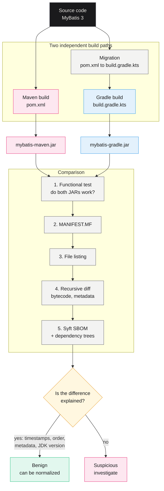
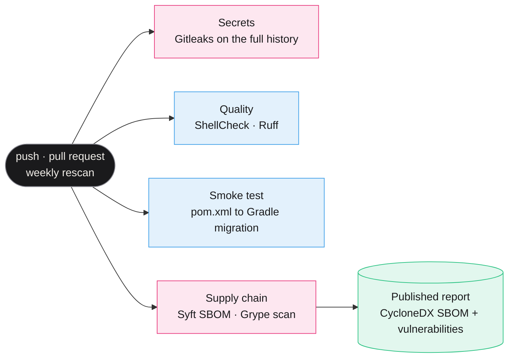

<p align="center">
  
</p>

<p align="center">
  <a href="https://github.com/salma2002ba/software-diversity-build-security/actions/workflows/devsecops.yml"></a>
  
  
  
</p>

<p align="center">
  
  
  
  
  
  
  
  
  
</p>

# Software Diversity – Build Pipeline Security

I carried out this research during my cybersecurity and DevSecOps internship at the
**Université de Montréal** (May – August 2025).

> **My starting question**: do two build systems, Maven and Gradle, produce the same artifact from
> the same source code? Where do they diverge, why, and can this diversity be used to detect a
> compromised build chain?

## Contents

- [Why this topic](#why-this-topic)
- [The method at a glance](#the-method-at-a-glance)
- [Results](#results)
- [Repository layout](#repository-layout)
- [Reproducing the experiments](#reproducing-the-experiments)
- [The repository's DevSecOps pipeline](#the-repositorys-devsecops-pipeline)
- [Tools](#tools) · [Future work](#future-work) · [References](#references)

---

## Why this topic

A software supply-chain attack does not target the source code, but what turns it into a
deliverable: the build system, its plugins, its dependencies. The reviewed code is clean, yet the
shipped artifact is not (SolarWinds is the best-known example).

The idea behind **software diversity**: if the same code is built through **two independent
paths**, an attacker has to compromise both in exactly the same way to go unnoticed. A divergence
between the two artifacts then becomes a **signal**, provided you can tell normal differences from
suspicious ones. That is what I set out to do.

## The method at a glance



### What I did

1. **Maven → Gradle migration**: converted the `pom.xml` into `build.gradle.kts`, reproduced the
   plugins and profiles, and checked functional equivalence. Part of it is automated in Python
   ([`Maven2Gradle_MigrationPython/`](Maven2Gradle_MigrationPython/)).
2. **Maven vs Gradle comparison**: diffoscope on the JARs, analysis of dependencies and SBOMs.
3. **Analysis of the differences**: timestamps, entry order, metadata, bytecode, `pom.properties`.
4. **Fixing the differences**: excluding timestamps, forcing a fixed JAR entry order, aligning
   `MANIFEST.MF`, pinning `targetCompatibility`, regenerating `pom.properties`.

## Results

Comparing the Maven and Gradle artifacts, I identified several sources of non-determinism. They
explain why two functionally equivalent builds can produce JARs that differ at the binary level.

| Source | Maven | Gradle | Explanation | Possible fix |
|---|---|---|---|---|
| **Timestamps** | Excluded automatically | Included | Every Gradle build writes different timestamps, hence different binaries | Exclude them explicitly (`preserveTimestamps`) |
| **JAR entry order** | Alphabetical | Not guaranteed | A varying file order inside the archive prevents reproducibility | Force a fixed order (`reproducibleFileOrder = true`) |
| **Metadata** | Rich (JDK, vendor, commit…) | Minimal | `MANIFEST.MF` content diverges and traceability drops | Align the `MANIFEST.MF` content |
| **Bytecode version** | Java 11 | Java 17 (default) | Affects compatibility and runtime behavior | Pin `targetCompatibility` |
| **`pom.properties`** | Generated (version, date) | Missing | Maven adds version information that Gradle does not reproduce | Regenerate it, or use it for traceability |

### What I take away from it

- **Maven** produces artifacts with richer metadata: better traceability, but more points of
  divergence.
- **Gradle**, by default, introduces non-determinism (timestamps, file order) and compiles to
  Java 17, which widens the gap.
- These differences are **benign** in normal conditions. Once they are known and normalized, any
  **additional divergence** becomes an **anomaly indicator**, for example a backdoor injected into
  only one of the two paths.

**In short**: diverse Maven and Gradle builds produce artifacts that differ but are both valid, and
they can serve as a cross-reference to detect suspicious behavior in the software supply chain.

### Follow-up study: Maven resolver diversity

The [`MavenBuildDiversity/`](MavenBuildDiversity/) folder applies the same idea inside Maven
itself: Maven 4's dependency-resolution strategies (collection, version-conflict selection, graph
traversal) are compared on a corpus of **572 projects** from
[Reproducible Central](https://github.com/aalmiray/reproducible-central), with a **dependency
hijacking attack** simulation and a test-suite verification on 359 projects. Method, data and
detailed results: [its README](MavenBuildDiversity/README.md).

## Repository layout

```text
.
├── M2G/                            Comparison of the Maven and Gradle JARs of MyBatis
│   ├── compare-maven-gradle.sh     5-step comparison pipeline
│   ├── manifest-*.txt              Extracted MANIFEST.MF files
│   ├── contents-*.txt              File listing of each JAR
│   ├── sbom-*-raw.json             Syft SBOM of each build
│   └── TestMyBatis.java            Functional test for both JARs
├── Maven2Gradle_MigrationPython/   Automated pom.xml to build.gradle.kts migration
├── treeDependencies/               Maven and Gradle dependency trees, comparison script
├── MavenBuildDiversity/            Study of Maven 4 resolution strategies
├── .github/workflows/devsecops.yml The repository's security pipeline
└── docs/                           README images
```

JARs and `.class` files are not committed: they can be regenerated by building MyBatis 3 with
Maven and with Gradle.

## Reproducing the experiments

**Requirements**: JDK 17, Maven, Gradle, Python 3, Docker (to run Syft and Grype without
installing them).

**1. Compare two JARs**, one built with Maven, the other with Gradle:

```bash
cd M2G
bash compare-maven-gradle.sh mybatis-maven.jar mybatis-gradle.jar
```

**2. Compare the dependency trees**, from the root of a project that has both builds:

```bash
bash treeDependencies/compare-deps.sh
```

**3. Migrate a `pom.xml` to Gradle**:

```bash
python3 Maven2Gradle_MigrationPython/migrate_pom_to_gradle.py path/to/pom.xml build.gradle.kts
```

**4. SBOM and vulnerabilities, with nothing to install**:

```bash
docker run --rm -v "$PWD":/src anchore/syft dir:/src -o cyclonedx-json=/src/sbom.cdx.json
docker run --rm -v "$PWD":/src anchore/grype sbom:/src/sbom.cdx.json
```

## The repository's DevSecOps pipeline

A repository about software supply-chain security should apply what it studies. On every push,
every pull request and **every Monday** (new CVEs are published even when the code does not
change), GitHub Actions runs four checks in parallel:



| Check | Tool | Blocking? | What it guarantees |
|---|---|---|---|
| Secrets | Gitleaks | Yes | No password, token or key in the code or in the Git history |
| Bash scripts | ShellCheck | Yes (errors) | No syntax or logic errors in the scripts |
| Python scripts | Ruff | Yes | No syntax errors or undefined names |
| Migration | Python | Yes | The migration script still generates a valid `build.gradle.kts` |
| SBOM | Syft | — | CycloneDX inventory of every component in the repository |
| Vulnerabilities | Grype | No (report) | Known CVEs, summarized on the run page |

**Why Grype does not block**: the repository deliberately keeps MyBatis's dependencies as they
were at the time of the study (2025). Upgrading them would distort the experiment, so the scan is
a published finding rather than a gate.

**Good practices applied to the pipeline itself**

- **Least privilege**: the GitHub token only has read access (`contents: read`).
- **Actions pinned to a commit SHA**, not a tag: a tag can be moved to malicious code, a SHA
  cannot.
- **Tool images pinned by digest**: every run uses exactly the same bytes.
- **Dependabot** proposes updates for the pinned actions.
- **Git credentials not kept** after checkout (`persist-credentials: false`).

## Tools

| Tool | Used for |
|---|---|
| Maven, Gradle | The build systems being compared |
| Syft, Grype | SBOM generation and vulnerability detection |
| diffoscope, meld | Comparing artifacts and directory trees |
| jnorm | Normalizing Gradle builds |
| Docker, Testcontainers | Reproducible test environments |
| Gitleaks, ShellCheck, Ruff | The repository's pipeline checks |

## Future work

- Automate more of the **Maven → Gradle migration** while preserving functional equivalence.
- **Automatically detect and classify** differences between artifacts: benign variations on one
  side, suspicious divergences on the other.
- **Simulate real attacks** (backdoor, *trusting trust*) to measure how well build diversity
  detects them.

## References

- Forrest et al., *Software Diversity: Divided We Win*.
- Fourné et al., *It's like flossing your teeth: On the Importance and Challenges of Reproducible Builds*.
- Xiong et al., *Towards Build Verifiability for Java-based Systems*.
- Apache, *Migrating Builds From Apache Maven*.
- DALEQ, *Explainable Equivalence for Java Bytecode*.
- NSTAC, *Beyond SolarWinds: Principles for Securing Software Supply Chains*.
- Thompson, *Reflections on Trusting Trust*.
- McDermott, *Countering Trusting Trust through Diverse Double-Compiling*.

---

<p align="center">
  <b>Salma Baba</b> · DevOps & DevSecOps Engineer ·
  <a href="https://salmababa.com">salmababa.com</a><br>
  <a href="LICENSE">MIT</a> license
</p>
